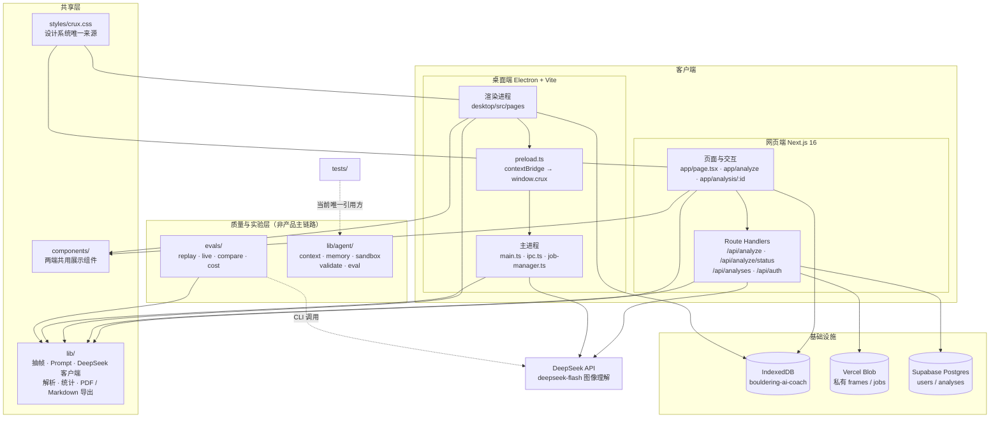
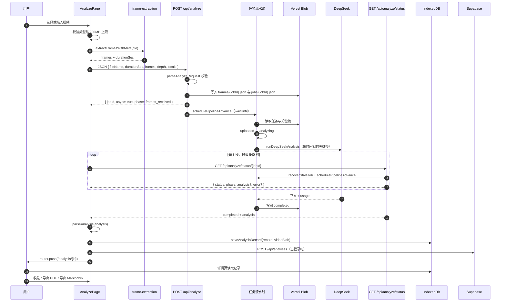
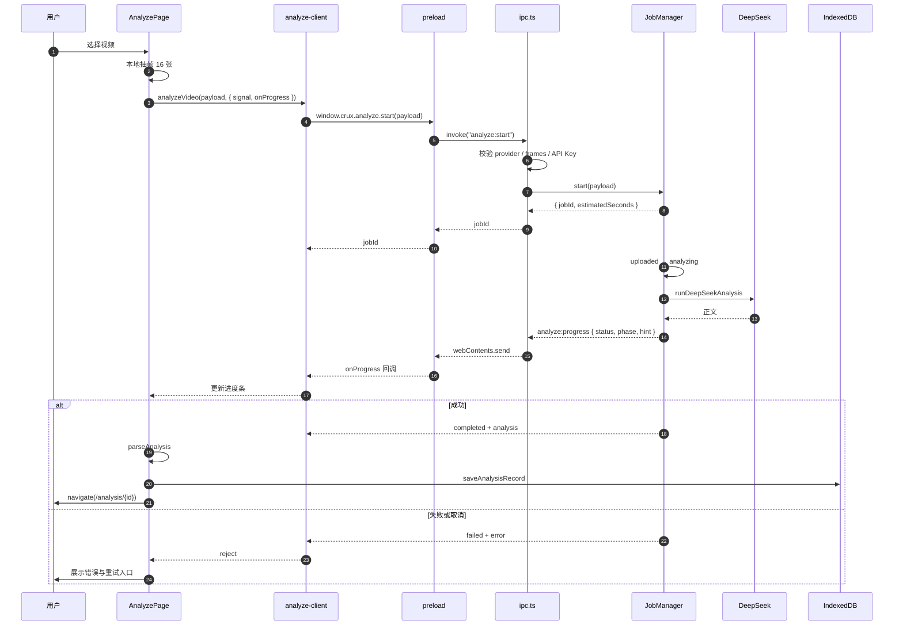
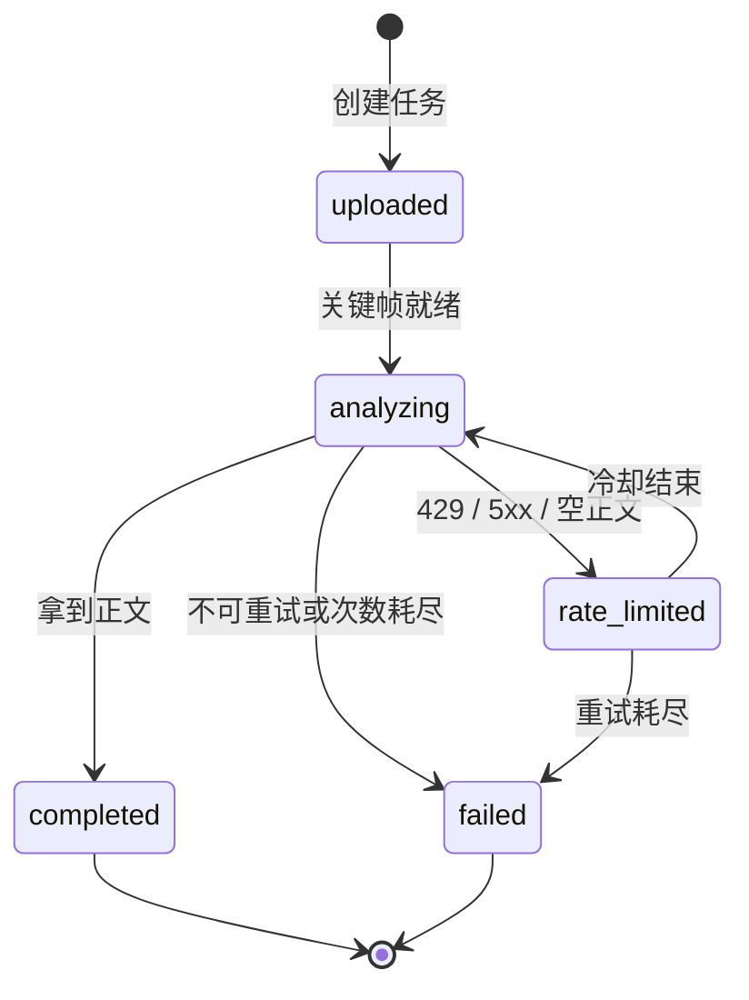
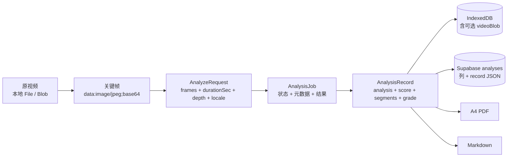
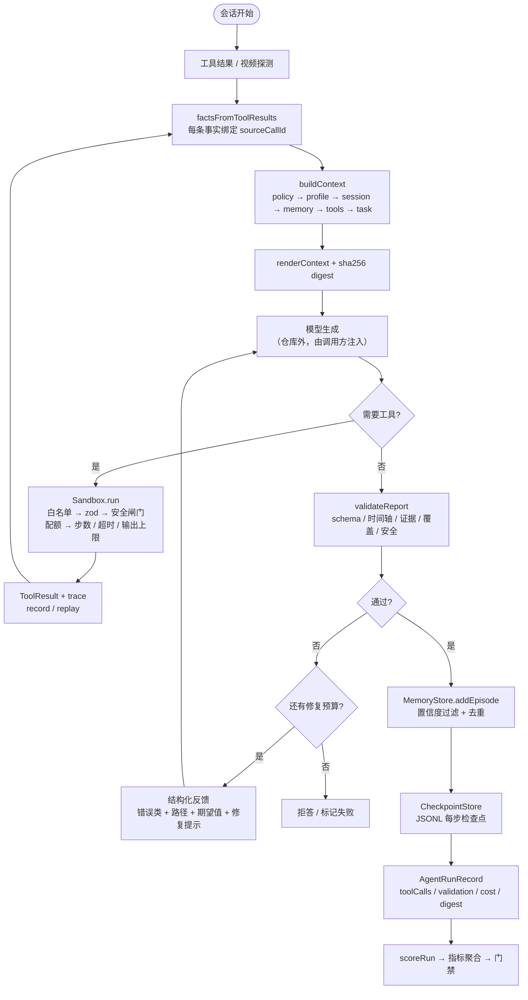

# CRUX 抱石项目架构说明

> 扫描基线：2026-11-04，分支 `feat/visual-refresh`，提交 `b65f99c`。
> 本文以当前代码为准，描述网页端、桌面端、共享领域层、质量评测链路，以及尚未接入产品流程的 Agent harness。

## 1. 项目概览与整体架构

CRUX 是一个抱石攀爬视频分析产品：用户选择一段攀爬视频，客户端在本地抽取关键帧，服务端把「带时间戳的关键帧」提交给 DeepSeek 的 `deepseek-flash` 做图像理解，最终得到带 `[MM:SS]` 时间戳的动作点评、评分、难度判断与训练建议。

项目有两种交付形态，共用同一套领域逻辑：

| 形态 | 技术栈 | 运行方式 | 分析调用路径 |
| --- | --- | --- | --- |
| 网页版 | Next.js 16 App Router + React 19 | Vercel / Node.js | 浏览器抽帧 → `POST /api/analyze` → 异步任务 → 状态轮询 |
| 桌面客户端 | Electron 44 + Vite + React 19 | Windows 安装包 / 便携版 | 渲染进程抽帧 → `preload` → 主进程 `JobManager` → DeepSeek |

两端共享的核心事实是：DeepSeek 官方 API 不接受视频，只接受图片。因此产品把「视频理解」拆成两步：

1. 客户端用 `<video>` + `<canvas>` 均匀抽取 JPEG 关键帧，并记录每帧的秒数与 `MM:SS` 时间戳。
2. 把关键帧按时间顺序提交给视觉模型，Prompt 明确要求模型只能依据离散画面判断，不能编造帧与帧之间的动作。

### 1.1 整体架构图



### 1.2 关键设计取舍

- **端侧抽帧，不上传原视频。** 原片留在浏览器或本机，服务端只接收最多 24 张、总量约 3.2MB 的 data URL。隐私更好，也绕开了大文件上传；代价是帧间连续动作不可见。
- **异步优先，规避 Serverless 时限。** 网页端在配置了 Blob 或内存任务表时返回 `jobId`，分析在 `waitUntil` 中推进，前端每 3 秒轮询一次状态。只有本地调试、没有任务存储时才走同步调用。
- **本地优先存储。** IndexedDB 是主存储，包含分析记录与可选的原片 Blob；登录后网页端把记录镜像到 Supabase，本地缺失时回源云端。
- **共享领域层，平台能力留在边界。** `lib/` 不依赖 `next/*` 或 `electron`；网页的文件下载、桌面的 IPC 与系统「另存为」都留在各自页面或平台目录。
- **契约优先、可回放的质量链路。** 解析器先尝试 v2 JSON 契约，失败回落 v1 文本正则；评测有固定夹具、轨迹指标、成本模型和门禁。

## 2. 目录结构分析

### 2.1 顶层结构

```text
my-bouldering-ai/
├─ app/                     网页端 App Router 页面与 Route Handlers
│  ├─ api/analyze/          POST 创建分析任务
│  ├─ api/analyze/status/   GET 查询任务状态
│  ├─ api/analyses/         登录用户的云端分析记录 CRUD
│  ├─ api/auth/             注册、登录、登出、当前用户
│  ├─ analyze/              上传与分析页
│  └─ analysis/[id]/        单条分析报告详情页
├─ components/              网页与桌面共用的展示组件
├─ styles/crux.css          两端共用的设计 token 与组件样式
├─ lib/                     共享领域逻辑
│  ├─ agent/                独立 Agent harness（当前仅测试引用）
│  └─ supabase/             服务端 Supabase 访问层
├─ desktop/
│  ├─ electron/             Electron 主进程
│  ├─ shared/               主进程与渲染进程的 IPC 契约
│  ├─ src/                  桌面渲染进程页面与平台适配
│  └─ tests/                桌面单元、组件、集成、E2E
├─ evals/                   离线 / 真实语料评测、成本模型与报告
├─ tests/                   网页与共享逻辑单元测试
├─ supabase/                数据库迁移与接入说明
├─ docs/                    产品、设计、质量与架构文档
├─ openspec/                变更提案与代码卫生规范
├─ skills/                  可复用技能定义
├─ public/                  静态资源
└─ scripts/                 抽帧等本地脚本
```

### 2.2 各层职责

| 层 | 目录 | 职责 | 边界约束 |
| --- | --- | --- | --- |
| 页面与交互 | `app/`、`desktop/src/pages`、`components/` | 选片、预览、抽帧进度、分析进度、报告展示、收藏、统计、导出 | 不直接持有模型密钥；平台 I/O 留在页面或 `desktop/src/lib` |
| 路由与接口 | `app/api/` | 请求校验、鉴权、任务创建/查询、云端记录 CRUD | 只在服务端读取 `DEEPSEEK_API_KEY`、`SUPABASE_SERVICE_ROLE_KEY` |
| 应用编排 | `lib/process-analysis-job.ts`、`desktop/electron/job-manager.ts` | 任务状态机、重试、限流冷却、卡死恢复、并发锁 | 不解析报告内容，不渲染 UI |
| 领域核心 | `lib/frame-extraction.ts`、`lib/analyze-request.ts`、`lib/deepseek-analysis.ts`、`lib/parse-analysis.ts`、`lib/analysis-schema.ts` | 抽帧、请求契约、模型调用、输出解析、领域模型 | 被两端复用的文件不 import `next/*` 或 `electron` |
| 持久化 | `lib/analysis-db.ts`、`lib/analysis-cloud.ts`、`lib/supabase/` | IndexedDB 主存储、云端镜像、行与领域对象互转 | 云端失败不能阻断本地使用 |
| 桌面平台 | `desktop/electron/`、`desktop/shared/`、`desktop/src/lib` | 窗口安全、IPC、设置与本地账户、文件保存 | IPC 只暴露白名单方法 |
| 质量评测 | `evals/`、`lib/eval-*.ts`、`lib/ai-cost.ts` | 夹具评测、真实语料评测、版本对比、成本与失败分类 | 只读 `lib`，不反向依赖页面 |
| Agent harness | `lib/agent/` | 上下文、记忆、沙箱、校验修复、轨迹评测 | 当前没有产品调用方 |
| 文档与规范 | `docs/`、`openspec/`、`skills/` | 产品需求、设计、质量口径、变更提案 | 不参与运行时 |

### 2.3 导入别名

| 环境 | 别名 | 指向 |
| --- | --- | --- |
| 网页 | `@/*` | 仓库根 |
| 桌面 | `@/*` | `desktop/src` |
| 桌面 | `@ui/*` | `components` |
| 桌面 | `@lib/*` | `lib` |
| 桌面 | `@shared/*` | `desktop/shared` |

桌面端在 `desktop/vite.config.ts` 与测试配置里固定了 `react`、`react-dom`、`lucide-react` 的解析路径，保证共享组件只使用一份 React 实例。

### 2.4 有意的双份文件

以下文件两端各有一份，因为差异落在路由 API 或传输层，强行合并会引入适配层：

| 文件 | 分叉原因 |
| --- | --- |
| `components/auth-nav.tsx` / `desktop/src/components/auth-nav.tsx` | Next `Link` 与 React Router `Link` |
| `components/auth-form.tsx` / `desktop/src/components/auth-form.tsx` | 表单跳转与登录通知来源不同 |
| `components/crux-header.tsx` / `desktop/src/components/crux-header.tsx` | 导航项与路由 API 不同 |
| `components/analysis-view.tsx` / `desktop/src/components/analysis-view.tsx` | 网页用浏览器下载，桌面用 IPC 保存 |
| `components/landing-home.tsx` / `desktop/src/pages/LandingPage.tsx` | 首页路由与图片组件不同 |
| `app/analyze/page.tsx` / `desktop/src/pages/AnalyzePage.tsx` | 网页走 HTTP 轮询，桌面走 IPC 事件 |
| `app/analysis/[id]/page.tsx` / `desktop/src/pages/AnalysisPage.tsx` | 路由参数与 Suspense 边界不同 |

仅网页服务端使用的 `lib` 文件包括 `auth-server.ts`、`auth-config.ts`、`db.ts`、`db-types.ts`、`supabase/`、`analysis-jobs.ts`、`job-memory-store.ts`、`process-analysis-job.ts`，它们不会进入桌面构建。

## 3. 核心模块职责分析

### 3.1 网页分析入口：`app/api/analyze/route.ts`

职责是按顺序完成「配置检查 → JSON 解析 → 请求校验 → 任务创建 → 调度或同步调用」。

关键行为：

1. 读取 `DEEPSEEK_API_KEY`，缺失直接返回 500。
2. 调用 `parseAnalyzeRequest` 校验请求体；校验失败返回 400 且 `retryable: false`。
3. 生成 `randomUUID()` 作为 `jobId`，记录 `promptVersion`、`depth`、`locale`、`model`、`frameCount`、`durationSec`。
4. 若存在 `BLOB_READ_WRITE_TOKEN`，把关键帧写入私有 Blob 的 `frames/{jobId}.json`，任务写入 `jobs/{jobId}.json`；否则若启用内存任务表，把关键帧与任务一起放进内存。二选一都没有时走同步调用。
5. 异步路径立即返回：

```json
{
  "id": "<jobId>",
  "jobId": "<jobId>",
  "async": true,
  "status": "processing",
  "phase": "frames_received",
  "estimatedSeconds": 63
}
```

6. 通过 `schedulePipelineAdvance(jobId)` 把实际推进放进 `waitUntil`。

同步路径只建议本地调试：直接用 `runDeepSeekAnalysis({ maxAttempts: 1 })`，完成即返回 `status: "completed"`。

### 3.2 任务持久化：`lib/analysis-jobs.ts` 与 `lib/job-memory-store.ts`

`AnalysisJob` 是网页端的任务实体，字段覆盖状态机需要的全部信息：

- 身份：`id`、`fileName`、`mimeType`、`createdAt`、`updatedAt`
- 输入：`framesBlobPath` 或内存 `frames`、`frameCount`、`durationSec`、`depth`、`locale`
- 执行：`status`、`statusSince`、`analysisStarted`、`analysisStartedAt`、`analysisAttempt`
- 重试：`retryAfter`、`pipelineLockUntil`
- 结果：`analysis`、`usage`、`error`、`logs`、`promptVersion`

存储有两种实现：

| 实现 | 开关 | 特点 |
| --- | --- | --- |
| Vercel Blob | `BLOB_READ_WRITE_TOKEN` | 私有读写，跨实例可见，适合生产 |
| 内存任务表 | `job-memory-store` 的启用条件 | 只适合本地 / 单实例调试，进程重启即丢失 |

### 3.3 状态查询：`app/api/analyze/status/[jobId]/route.ts`

每次轮询做三件事：

1. 从内存或 Blob 读取任务；不存在返回 404。
2. 对未完成任务调用 `recoverStaleJob(jobId)`，修复卡死或限流冷却已结束的任务。
3. 调用 `schedulePipelineAdvance(jobId)`，让后台继续推进，然后立即返回当前状态。

返回字段中的 `phase` 是稳定的前端协议：

| `status` | `phase` |
| --- | --- |
| `uploaded` | `phase_received` |
| `analyzing` | `phase_analyze` |
| `rate_limited` | `rate_limited` |
| `completed` | `done` |
| `failed` | `failed` |

### 3.4 任务推进与恢复：`lib/process-analysis-job.ts`

这是网页端最核心的编排模块，解决三个 Serverless 环境下的现实问题：

- **请求不能等太久。** 分析放到 `waitUntil` 的后台任务里执行，状态接口只做短查询。
- **多实例可能同时推进。** `pipelineLockUntil` 提供 120 秒的软锁，拿到锁的实例才继续。
- **后台任务可能静默死掉。** 轮询时检查 `statusSince` / `analysisStartedAt`：
  - `uploaded` 卡住超过 60 秒：重新排队。
  - `analyzing` 已开始但超过 120 秒无进展：后台重试，最多 3 次。
  - `rate_limited` 且 `retryAfter` 已到：回到 `analyzing` 重新提交。

每次 `advanceAnalysisJob` 只推进一个阶段：

```text
uploaded  → 标记 analyzing、记录 analysisAttempt → waitUntil 执行 DeepSeek
analyzing → 若尚未开始，设置 analysisStarted + analysisStartedAt → waitUntil 执行
rate_limited → 冷却结束 → 回到 analyzing → waitUntil 执行
completed / failed → 直接返回
```

`executeAnalysisInBackground` 读取关键帧、调用 `runDeepSeekAnalysis({ maxAttempts: 1 })`，成功写回正文、模型、usage，失败交给 `persistAnalysisError` 判定是否可重试。

### 3.5 抽帧：`lib/frame-extraction.ts`

抽帧完全在客户端完成，纯函数 `planFrameTimestamps` 负责时间点规划：

- 默认 16 帧，内部上限 32 帧。
- 起点取 `min(0.4s, 时长 × 2%)`，终点取 `时长 × 98%`，避开开头与结尾黑帧。
- 时间点在起点与终点之间均匀分布，保留两位小数。
- 输出每帧 `{ seconds, timestamp, dataUrl }`，时间戳格式为 `MM:SS`。

图像参数：

| 参数 | 值 |
| --- | --- |
| 单帧最长边 | 768px |
| JPEG 质量 | 0.72 |
| 单帧 data URL 上限 | 400,000 字符 |
| 请求最多帧数 | 24 |
| 全部 data URL 上限 | 3,200,000 字符 |
| 原始视频上限 | 200MB |
| 视频时长上限 | 600 秒 |

`resolveDuration` 处理了 MediaRecorder 生成的 WebM 常见问题：`duration` 为 `Infinity` 时，用一次超大 `currentTime` seek 逼浏览器解析真实时长。

### 3.6 请求契约：`lib/analyze-request.ts`

`parseAnalyzeRequest` 是路由与测试共用的纯函数，逐项校验：

- `frames` 必须是非空数组，且不超过 24 张。
- 每帧 `seconds` 必须是非负有限数。
- `timestamp` 必须匹配 `^\d{2}:\d{2}$`。
- `dataUrl` 必须是 `data:image/(jpeg|png|webp);base64,` 开头。
- 单帧不超过 400,000 字符，累计不超过 3,200,000 字符。
- `durationSec` 必须在 `(0, 600]`。
- `fileName` 截断到 200 字符，空值回落为 `climb.mp4`。
- `depth` 只接受 `light | deep`，其他值按 `deep`。
- `locale` 只接受 `zh | en`，其他值按 `zh`。

### 3.7 Prompt 与 DeepSeek 客户端

**生产链路使用的 Prompt 在 `lib/deepseek-analysis.ts` 的 `getFrameAnalysisPrompt`。**

它把角色、逐帧分析要求、五维关注点、风格约束、时间戳格式、难度格式、评分格式和「输入是离散关键帧」的免责声明写在一起。每张图前再插入一行：

```text
第 3/16 帧 · 时间 00:07
```

请求体是 OpenAI 兼容的 Chat Completions：

```json
{
  "model": "deepseek-flash",
  "messages": [
    {
      "role": "user",
      "content": [
        { "type": "text", "text": "<prompt + 时间顺序说明>" },
        { "type": "text", "text": "第 1/16 帧 · 时间 00:00" },
        { "type": "image_url", "image_url": { "url": "data:image/jpeg;base64,..." } }
      ]
    }
  ],
  "max_tokens": 16384,
  "stream": false
}
```

| 模式 | 输出上限 | thinking |
| --- | --- | --- |
| `light` | 4,096 token | `{ "type": "disabled" }` |
| `deep` | 16,384 token | 不显式设置 |

重试与错误映射：

- 可重试 HTTP 状态：408、429、500、502、503、504。
- 429 等待 20 秒，5xx 等待 15 秒，空正文等待 6 秒，网络错误等待 10 秒。
- 401（Key 无效）、402（余额不足）、400/422（请求被拒）不重试。
- 空正文按 `finish_reason` 区分：`length` 提示改用轻量模式，`content_filter` 提示换片段，其余按可重试处理。
- 返回真实 `usage`，包括 `prompt_tokens`、`completion_tokens`、`total_tokens`、`prompt_cache_hit_tokens`。

> **实现差异提示：** `lib/analyze-prompt.ts` 里还有一套 v1/v2 输出契约与 `ACTIVE_CONTRACT`，但它只被 `evals/` 和测试引用。网页与桌面的实际分析请求都走 `getFrameAnalysisPrompt`，记录里写入的是 `FRAME_PROMPT_VERSION = "2026-11-1"`。阅读代码时不要把 `ACTIVE_CONTRACT` 当成生产开关。

### 3.8 输出解析：`lib/parse-analysis.ts` 与 `lib/analysis-schema.ts`

解析器是「先契约、后兼容」的两级结构：

1. `parseAnalysisContract` 从文本中提取 JSON（优先 ```json 代码块，其次第一个 `{` 到最后一个 `}`），用 Zod 校验：
   - `grade`: `V0`–`V10` 或 `null`
   - `score`: 0–100
   - `dimensionScores`: `hips`、`power`、`feet`、`sequence`、`completion`，各 1–5
   - `segments`: 至少 1 条，`t` 为 `MM:SS`，`evidence` 至少 4 字符，`fix` 可选
   - `dimensionSummary`、`improvements`、`overallAdvice` 可选
2. 契约失败时走 `parseLegacyAnalysis`：
   - 正则提取「评分：NN/100」「教练金句：…」
   - 逐行匹配 `[MM:SS] 内容` 形成时间轴
   - 其余行拼成 `summary`
   - 再调用 `parseStructuredReport` 与 `parseGradeFromText`

最终统一为 `ParsedAnalysis`，供 UI 直接消费：

```ts
{
  raw: string;
  score: number | null;
  highlight: string | null;
  grade?: BoulderGrade;
  segments: { timestamp, seconds, content }[];
  summary: string;
  structured: StructuredReport;
}
```

`sanitizeSegments` 会过滤超出 `durationSec + 2` 的时间点并按秒数排序。

### 3.9 本地存储与云端镜像

**IndexedDB：`lib/analysis-db.ts`**

- 数据库：`bouldering-ai-coach`，版本 3，对象仓库 `analyses`，主键 `id`，索引 `createdAt`。
- 记录类型：`AnalysisRecord & { videoBlob?: Blob }`。
- 原片只在不超过 80MB 时保存；大文件只保留缩略图，避免撑爆配额。
- `getAnalysisRecord` 先读本地，未命中再回源云端；`listAnalysisRecords` 合并本地与云端，只补本地缺失的 id，不覆盖本地版本。
- `patchAnalysisRecord` 用于收藏、备注等字段合并，保留 `videoBlob`。

**云端镜像：`lib/analysis-cloud.ts` + `app/api/analyses/`**

- `POST /api/analyses` 写入或更新记录；`PATCH /api/analyses/[id]` 更新；`DELETE` 删除；`GET` 列表或单条。
- 必须登录；服务端从会话 JWT 取用户，不信任请求体里的用户 id。
- `thumbnail` 超过 2,000,000 字符会被清空，避免请求体过大。
- `analyses` 表同时保存拆出的关键列与完整 `record` JSON，列优先、`record` 兜底。
- `assertOwnership` 防止同 id 覆盖其他用户的记录。
- 浏览器端有 `cloudUnavailable` 缓存：服务端明确返回「Supabase 未配置」后不再重复请求。
- 所有云端调用都是尽力而为，失败不会阻断本地保存。

**鉴权：`lib/auth-server.ts` + `app/api/auth/`**

- 密码使用 bcrypt（10 rounds）哈希。
- 会话使用 `jose` 签发的 HS256 JWT，写入 `httpOnly`、`sameSite=lax` Cookie，生产环境加 `secure`。
- 注册时校验邮箱格式与密码长度（至少 8 位）。

### 3.10 桌面端主进程

**`desktop/electron/main.ts`**

- 单实例锁：第二次启动只聚焦已有窗口。
- 生产环境用自定义 `app://bundle` 协议加载 `dist/`，保证 SPA 深链可用，并给渲染进程一个稳定 origin，使 IndexedDB 能持久化。
- 协议处理做了目录穿越防护：解析后的路径必须位于 `dist` 内，否则返回 403；资源缺失回落 `index.html`。
- 生产环境注入严格 CSP：`default-src 'self'`，禁止 `object-src`、`form-action`，图片/媒体允许 `data:`、`blob:`。
- 窗口安全：`contextIsolation: true`、`nodeIntegration: false`、`sandbox: true`。
- 导航守卫：站外链接交给系统浏览器，窗口内不允许跳走。

**`desktop/electron/preload.ts`**

通过 `contextBridge.exposeInMainWorld("crux", api)` 暴露五组能力：

| 命名空间 | 方法 |
| --- | --- |
| `settings` | `get`、`setProvider`、`setApiKey`、`setModel` |
| `analyze` | `start`、`cancel`、`onProgress` |
| `auth` | `me`、`register`、`login`、`logout` |
| `files` | `saveText`、`saveBinary`、`openPath` |
| `app` | `info`、`openExternal` |

**`desktop/electron/ipc.ts`**

- 注册 `settings:*`、`analyze:*`、`auth:*`、`files:*`、`app:*` 处理器。
- `analyze:start` 先校验 provider、关键帧和 API Key，再交给 `JobManager`。
- 进度通过 `broadcast("analyze:progress", event)` 推给所有窗口。

### 3.11 桌面任务状态机：`desktop/electron/job-manager.ts`

桌面端没有 Serverless 时限，因此状态机更直接：

- `start` 创建任务，状态 `uploaded`，立即异步执行。
- 每次尝试调用注入的 `run`，并让它与取消信号 `Promise.race`。
- 成功 → `completed`；取消 → `failed`，错误文案为「已取消分析。」。
- 失败按 `classifyAnalysisError` 判定：
  - 不可重试或次数耗尽 → `failed`。
  - 可重试 → 写 `retryAfter`、状态 `rate_limited`、等待冷却后再试。
- 默认最多 3 次尝试；日志最多保留 40 条。
- `estimatedSeconds = min(120, 30 + ceil(compressedSize / 512KB))`。

### 3.12 桌面 DeepSeek 执行器与客户端

**`desktop/electron/deepseek-runner.ts`**

- 延迟读取 API Key 与模型名，用户在设置里刚填的 Key 立即生效。
- 校验 Key 与关键帧，状态切到 `analyzing`。
- 调用共享的 `runDeepSeekAnalysis`，`maxAttempts: 1`，跨轮询重试交给 `JobManager`。

**`desktop/src/lib/analyze-client.ts`**

- 调用 `window.crux.analyze.start(payload)`。
- 在拿到 `jobId` 之前到达的进度事件先缓存，拿到后按 `jobId` 回放，避免丢失最早的 `uploaded` 状态。
- `completed` 且有正文时 resolve；`failed` 时 reject；`AbortSignal` 触发取消并调用 `analyze:cancel`。

### 3.13 报告导出与统计

**PDF：`lib/generate-analysis-pdf.ts` + `components/analysis-pdf-template.tsx`**

1. 把隐藏的 A4 模板 DOM 临时固定到视口内，等待两帧 `requestAnimationFrame` 完成布局。
2. `html2canvas` 渲染为 canvas；PNG 编码失败时回落 JPEG 0.9。
3. `jsPDF` 创建 A4 纵向文档，按比例计算绘制位置并 `addImage`，固定输出一页。
4. `pdf-html2canvas-fix.ts` 在克隆文档中剥离 Tailwind 全局样式里的 `oklab/oklch`，避免 html2canvas 解析失败。
5. 网页端 `downloadAnalysisPdf` 直接下载；桌面端 `buildAnalysisPdfBytes` 返回字节，交给 IPC 的系统「另存为」。

**Markdown：`lib/export-analysis.ts`** 输出文件名、时间、Prompt 版本、深度、语言、评分、金句、全文与时间轴。

**统计与收藏：**

- `lib/climbing-stats.ts` 汇总总爬升、当月次数、平均分、最高 V 级，并按天生成 `DayStat`。
- `lib/bookmarks.ts` 汇总所有记录里的 `bookmarkedSegmentIndices`，生成可跳回原视频秒数的收藏项。

### 3.14 质量评测链路

`evals/` 是一套可执行的离线质量运营工具，不是产品运行时：

| 能力 | 入口 | 产出 |
| --- | --- | --- |
| 合成夹具回归 | `npm run eval` | `evals/runs/<runId>/report.md` + `results.json` |
| 真实语料评测 | `npm run eval:live` | 结构指标、真实 token、真实耗时 |
| 两版对比 | `npm run eval:compare` / `eval:live:compare` | 对比报告与上线判定 |
| 成本模型 | `npm run cost:report` | `docs/quality/cost-model.md` |
| 真实语料抓取 | `npm run corpus:fetch` | `evals/private/corpus/manifest.json` |

指标覆盖格式合法率、时间戳可定位率、关键线索覆盖率、空话率、重复片段率、难度一致率、五维 MAE 与综合质量分；失败码和修复建议集中在 `lib/failure-taxonomy.ts`。当前合成夹具只验证脚本与指标口径，不代表真实模型质量。

## 4. 数据流与用户请求生命周期

### 4.1 网页端完整时序



网页端生命周期可以分成六段：

1. **预处理。** 文件类型、200MB 上限、`durationSec ≤ 600` 在浏览器端先拦一遍；抽帧进度通过 `onProgress(done, total)` 反馈。
2. **提交。** `POST /api/analyze` 只接收关键帧，不接收原视频。异步模式下立即返回 `jobId`。
3. **后台分析。** `waitUntil` 推进状态机；状态接口每次轮询都会顺手做卡死恢复与再次调度。
4. **轮询。** `pollUntilComplete` 每 3 秒请求一次，最长 540 秒；429 时展示 `retryAfter` 倒计时。
5. **落库。** 解析正文得到 `score`、`highlight`、`segments`、`grade`，组装 `AnalysisRecord`，写 IndexedDB；登录时异步镜像 Supabase。
6. **消费。** 详情页读本地记录，恢复视频 URL，渲染时间轴、评分、结构化建议；收藏通过 `patchAnalysisRecord` 同时更新本地与云端。

### 4.2 桌面端完整时序



桌面端与网页端最大的差别在传输层：网页用 HTTP 轮询，桌面用长期存活的 IPC 事件推送。渲染进程不需要知道任务如何重试，只需要消费 `AnalyzeProgressEvent`。

### 4.3 任务状态机



两端共享状态名与 `phase` 映射，但恢复策略不同：

| 机制 | 网页端 | 桌面端 |
| --- | --- | --- |
| 重试驱动 | 轮询触发 `recoverStaleJob` + `waitUntil` | `JobManager.execute` 内部循环 |
| 并发保护 | `pipelineLockUntil` 120 秒软锁 | 单进程内 `Map`，无需跨实例锁 |
| 卡死判定 | `analysisStartedAt` 超过 120 秒 | 依赖请求自身的超时 / 取消 |
| 最大尝试 | 后台 3 次 | 默认 3 次 |
| 取消 | 前端 `AbortController` 停止轮询 | `Promise.race` 立即结束并标记失败 |
| 限流冷却 | `retryAfter`，轮询时恢复 | `retryAfter`，`sleep` 后重试 |

### 4.4 失败、限流与恢复

| 场景 | 表现 | 处理 |
| --- | --- | --- |
| 未配置 `DEEPSEEK_API_KEY` | 网页 500；桌面启动前提示 | 不创建任务 / 任务直接 `failed` |
| 请求体不合法 | 400，`retryable: false` | 前端提示重新选择视频 |
| DeepSeek 429 | `rate_limited` + `retryAfter` | 网页 20 秒后恢复；桌面 `sleep` 后重试 |
| DeepSeek 5xx | `rate_limited` | 15 秒后重试 |
| 空正文 / 截断 | 可重试错误 | 提示改用轻量模式或换短片段 |
| 401 / 402 | 不可重试 | 提示检查 Key 或充值 |
| 网页后台卡死 | `analyzing` 超过 120 秒 | 后台重试，最多 3 次 |
| 网页轮询超时 | 540 秒 | 抛出带 `jobId` 的超时错误，建议查 Logs |
| 用户取消 | 前端停止等待 | 网页停止轮询；桌面标记 `failed` 并写「已取消分析。」 |
| Supabase 未配置 / 未登录 | 云端接口返回空或 503 | 本地记录照常保存 |

### 4.5 数据格式与持久化边界



- 原视频只在不超过 80MB 时进入 IndexedDB；超过则只保留 320px 缩略图。
- 云端不保存视频 Blob，只保存缩略图（有 2MB 字符上限）与报告字段。
- `AnalysisRecord` 是 UI、统计、收藏、导出的共同契约；`AnalysisJob` 只存在于任务执行期。
- 桌面端的 `app://bundle` origin 让 IndexedDB 在打包应用里保持稳定；开发模式使用 Vite 的 `http://localhost:5273`。

### 4.6 安全与隐私边界

- `DEEPSEEK_API_KEY` 只出现在网页 Route Handler 或桌面主进程；渲染进程通过 IPC 触发分析，不接触密钥。
- 桌面 `settings-store` 把设置写入应用数据目录；`auth-store` 使用 `scrypt` 派生哈希，账户保存在本地 `accounts.json`。
- 网页的 Supabase `service_role` 只在服务端 Route Handler 使用，浏览器不直连数据库。
- 桌面沙箱（用于 Agent harness）默认只透传运行必需的环境变量，API Key、数据库连接串不会进入子进程。

## 5. Agent 执行流程分析

### 5.1 定位：独立 harness，尚未接入产品

`lib/agent/` 是一套围绕「抱石教练 Agent」设计的独立能力层，包含上下文组装、长期记忆、工具沙箱、输出校验修复、轨迹评测五个子系统。它当前的引用方只有 `tests/`：

- `tests/context-builder.test.ts`
- `tests/memory-store.test.ts`
- `tests/sandbox-runner.test.ts`
- `tests/sandbox-safety.test.ts`
- `tests/agent-validate.test.ts`
- `tests/agent-eval.test.ts`

网页与桌面的实际分析链路是**单次模型调用**：

```text
关键帧 → 一次 Chat Completions → 正文 → 解析 → 入库
```

它没有工具调用循环，没有会话事实，没有记忆写入，也没有校验修复。`lib/agent/` 描述的是「如果要做多步、可验证、可回放的教练 Agent，应该具备哪些部件」，不是当前产品正在运行的流程。

### 5.2 设计中的 Agent 执行流程



图中「模型生成」是唯一不在仓库里的环节。`runRepairLoop` 接收调用方传入的 `generate` 函数，`runAgentEval` 接收 `runCase`，所以 harness 本身不绑定具体模型或 SDK。

### 5.3 上下文组装：`lib/agent/context/`

固定顺序，不允许模型决定裁剪：

```text
系统策略 → 用户档案 → 本次训练 → 可比历史 → 工具结果 → 当前任务
```

默认预算：

| 分区 | token |
| --- | --- |
| 总计 | 6,000 |
| `policy` | 600 |
| `profile` | 400 |
| `session` | 1,400 |
| `memory` | 1,200 |
| `tools` | 2,000 |
| `task` | 400 |

关键规则：

- `estimateTokens`：CJK 字符按 1 token，其他字符按 4 字符 1 token；只用于预算，不用于计费。
- `truncateText` 按行裁剪，`head` 保留开头，`tail` 保留结尾。
- `session` 预算不足时先丢最早的事实，再丢末尾的待确认项。
- `memory` 按分数、时间、id 稳定排序；装不下的记录写入 `dropped`，原因为 `budget`。
- `tools` 新的在前，预算不够丢最旧的，并插入「较早 N 条已省略」。
- `digest` 对分区 id + 内容做 SHA-256，取前 16 位；同样输入必须得到同样 digest，用于回放比对。

### 5.4 会话事实：`lib/agent/context/facts.ts`

事实只能来自工具结果：

- `ToolResult.ok` 为 false 时跳过。
- 工具返回 `data.events` 时，每个事件映射为 `kind: "kinematic"` 的 `SessionFact`。
- `video.probe` 的时长映射为 `kind: "constraint"` 的事实。
- 每条事实都有 `sourceCallId`，这是后续「证据校验」能追到工具调用的基础。
- 最终按 `atSec`、`id` 稳定排序。

### 5.5 工具沙箱：`lib/agent/sandbox/`

`Sandbox` 是工具执行的唯一入口，按以下顺序拦截：

1. **步数上限。** 默认 24 步。
2. **工具白名单。** `ToolRegistry` 没注册的名字直接 `E_TOOL_UNKNOWN`。
3. **参数校验。** 每个工具用 Zod 定义输入，失败返回 `E_ARGS_INVALID` 与字段路径。
4. **安全闸门。** `checkSafety` 用纯规则拦截：
   - 提示词注入：忽略既有指令、读取 system prompt、jailbreak。
   - 自伤风险：自杀、自残、轻生。
   - 医疗建议：诊断、处方、用药、剂量、手术、康复方案。
   - 凭据：`sk-` 开头的 Key、`api_key=...`、`access_token=...`。
   - PII：手机号、邮箱、身份证号。
   命中后返回 `E_SAFETY_BLOCKED`，记录 escalation，凭据与 PII 会脱敏。
5. **单工具配额。** `maxCallsPerRun`。
6. **录制 / 回放。** `record` 模式把 `tool + argsHash` 的结果写入 `.sandbox/tool-results.json`；`replay` 模式缺结果返回 `E_REPLAY_MISS`。
7. **执行。**
   - `command` 工具：`spawn`，`shell: false`，工作目录固定为 workspace，环境变量只透传 allowlist，超时默认 30 秒、上限 600 秒，stdout/stderr 各 1MB。
   - `handler` 工具：`Promise.race` 超时，超时后 abort 信号。
8. **事后审计。** `snapshotTree` 只记路径、大小、mtime；`diffTrees` 得到 added/modified/deleted；`findViolations` 把 allowlist 之外的变化列为越界。

`Sandbox` 还输出 `trace()`、`escalationLog()`、`summary()`，为评测提供可回放证据。

内置工具目前只有 `video.probe`：只读调用 `ffprobe`，读取时长、分辨率、编码，输入路径必须是 workspace 内相对路径，单次运行最多 4 次。

### 5.6 长期记忆：`lib/agent/memory/`

三层分开存储：

| 层 | 内容 | 写入策略 |
| --- | --- | --- |
| `profiles` | 水平、目标、伤病、语言、语气 | 只能由用户本人填写；模型推断返回 `PROFILE_REQUIRES_USER_STATED` |
| `episodes` | 每次训练的问题、时间点、置信度、计划 | 置信度 < 0.6 或描述过短的问题被过滤；没有有效问题不写；同一 `sourceSessionId` 去重 |
| `preferences` | 术语替换偏好 | 第一次只记录不生效；同一替换出现 2 次才 `confirmed: true` |

检索规则：

- 过滤条件：同 `userId`、同 `grade`、同 `angle`。
- TTL 默认 180 天，过期记录保留但不参与对比。
- 分数 = `recency × 0.7 + lighting × 0.3`，其中 `lighting` 好为 1、其他为 0.5。
- 默认返回 3 条，附 `reason`（同难度、同机位、多少天前）。

记忆文件是单个 JSON，写入通过 `writeChain` 串行化，避免并发覆盖。

### 5.7 输出校验与修复：`lib/agent/validate/`

`validateReport` 分五层检查：

| 层 | 错误码 | 规则 |
| --- | --- | --- |
| 契约 | `E_SCHEMA` | 必须是可解析且符合 `analysisContractSchema` 的单个 JSON |
| 时间轴 | `E_TIMESTAMP_OUT_OF_RANGE`、`E_TIMESTAMP_NOT_MONOTONIC`、`E_DUPLICATE_TIMESTAMP` | `t ≤ duration + 2`、单调递增、不重复 |
| 证据 | `E_CLAIM_WITHOUT_EVIDENCE` | 每条点评必须落在某个工具事实的 ±2.5 秒内 |
| 覆盖 | `E_COVERAGE_MISS` | 置信度 ≥ 0.7 的非约束事实必须至少被一条点评覆盖 |
| 数量 | `E_TOO_FEW_SEGMENTS` | 默认至少 2 条 |
| 安全 | `E_SAFETY_BLOCKED` | 对正文再过一次 `checkSafety` |

错误分为四类：

- `E1`：格式 / 时间轴，可通过重写修复。
- `E2`：无证据结论，必须重新调用工具拿证据，不允许只改时间戳。
- `E3`：覆盖不足，补点评。
- `E4`：安全红线，默认 0 次重试。

`runRepairLoop` 的默认策略：

```ts
{
  maxAttempts: 3,
  budgets: { E1: 2, E2: 1, E3: 1, E4: 0 }
}
```

每轮把问题转成结构化反馈（错误类、路径、期望值、实际值、修复提示）再交给 `generate`。E4 没有预算，因为「让模型重试安全红线」等于教它绕过拦截。

### 5.8 检查点与轨迹评测：`lib/agent/context/checkpoint.ts`、`lib/agent/eval/`

**检查点。** 每步写一行 JSONL：

```ts
{
  runId, step, at,
  stateDigest,
  contextDigest,
  state,
  context
}
```

用于崩溃续跑和回放对齐；`latest(runId)` 取最后一步。

**轨迹指标。**

- `toolRecall`：必需工具被调用的比例。
- `toolPrecision`：调用落在允许集合内的比例。
- `orderViolations`：`oracleTools` 与实际调用序列的最长公共子序列之差。
- `redundantCalls`：`tool + argsHash` 重复的调用数。
- `steps` / `stepRatio`：实际步数与 oracle 步数比。
- `unsupportedClaims`：`E_CLAIM_WITHOUT_EVIDENCE` 数量。

**单次运行判定。** 以下任一条件触发失败：

```text
validation-failed
missing-required-tool
unexpected-tool
tool-order-violation
redundant-call
step-budget
cost-budget
```

**聚合与门禁。**

- `runPassRate`：通过运行数 / 总运行数。
- `casePassRate`：至少通过一次的 case 占比。
- `passPowK`：同一 case 的 k 次运行全部通过的占比。
- `p50/p90`：时延与成本用最近秩法。
- 默认门禁：`passPowK ≥ 0.8`、`P90 时延 ≤ 120s`、`P90 成本 ≤ $0.5`、平均顺序违规 = 0。
- `runHarnessSelfTest` 要求 oracle 100% 通过，且 7 类已知违规 100% 被抓；否则指标本身不可信。

**批量运行。** `runAgentEval` 按 `cases × configs × k` 生成任务，支持并发、JSONL 断点续跑，报告是运行记录的纯函数；同样输入与固定 `now` 会得到完全一致的报告。

### 5.9 当前接入缺口

以当前代码为准，Agent harness 还缺三块产品化连接：

1. **没有顶层 Agent 循环。** 仓库里没有把「模型 → 工具 → 事实 → 上下文 → 模型」串起来的 runner；现有代码提供的是可组合部件与测试。
2. **没有真实工具集。** 除 `video.probe` 外，没有姿态估计、帧提取、记忆写入等工具实现。
3. **没有产品调用方。** 网页和桌面都不会创建 `Sandbox`、`MemoryStore` 或 `runRepairLoop`；分析结果仍由单次 DeepSeek 调用产生。

这也意味着：当前产品的质量保障主要依赖 Prompt、输出解析、评测夹具和人工检查，而不是 Agent 的运行时校验。

## 6. 关键实现差异与风险清单

| 事项 | 当前事实 | 影响 |
| --- | --- | --- |
| 生产 Prompt 与 `analyze-prompt.ts` | 生产用 `getFrameAnalysisPrompt`；`ACTIVE_CONTRACT` 只被评测与测试引用 | 修改 `ACTIVE_CONTRACT` 不会改变线上分析 |
| v2 契约 | `analysis-schema.ts` 与解析器已支持；生产 Prompt 仍要求自由文本 + `难度/评分/金句` | 线上主要走 v1 解析；v2 主要用于评测对比 |
| Agent harness | 仅 `tests/` 引用 | 不能把 `lib/agent/` 当作当前分析引擎 |
| 桌面云端同步 | 桌面调用共享 `analysis-db`，但 `analysis-cloud` 请求相对 `/api/analyses`；桌面没有对应 HTTP 服务或代理 | 打包桌面端实际以本地 IndexedDB 为主，云端镜像静默跳过 |
| 桌面账户 | 本地 `accounts.json` + `scrypt`，与网页 Supabase 账户不互通 | 两端用户体系独立 |
| 网页删除记录 | `DELETE /api/analyses/[id]` 与 `deleteAnalysisInCloud` 存在 | 页面暂无删除入口 |
| 评测语料 | `evals/private/corpus` 为本地私有视频，不进仓库 | 新环境只能跑合成夹具 |
| 评测文档 | `evals/README.md` 仍提到 Gemini 与旧链路 | 以 `evals/live.ts` 与 `lib/deepseek-analysis.ts` 的实际代码为准 |

## 7. 阅读与验证入口

按调用链阅读，比按目录顺序更高效：

1. **网页主链路**
   `app/analyze/page.tsx` → `lib/frame-extraction.ts` → `app/api/analyze/route.ts` → `lib/analyze-request.ts` → `lib/process-analysis-job.ts` → `lib/deepseek-analysis.ts` → `lib/parse-analysis.ts` → `lib/analysis-db.ts` → `app/analysis/[id]/page.tsx`
2. **桌面主链路**
   `desktop/src/pages/AnalyzePage.tsx` → `desktop/src/lib/analyze-client.ts` → `desktop/electron/preload.ts` → `desktop/electron/ipc.ts` → `desktop/electron/job-manager.ts` → `desktop/electron/deepseek-runner.ts`
3. **存储与账户**
   `lib/analysis-db.ts` → `lib/analysis-cloud.ts` → `app/api/analyses/route.ts` → `lib/supabase/analysis-repo.ts`；网页鉴权看 `lib/auth-server.ts`，桌面鉴权看 `desktop/electron/auth-store.ts`
4. **质量链路**
   `evals/run.ts` / `evals/live.ts` → `lib/eval-metrics.ts` / `lib/eval-structural.ts` → `lib/failure-taxonomy.ts` → `evals/runs/*/report.md`
5. **Agent harness**
   `lib/agent/context/builder.ts` → `lib/agent/sandbox/runner.ts` → `lib/agent/memory/store.ts` → `lib/agent/validate/repair.ts` → `lib/agent/eval/runner.ts`

常用验证命令：

```bash
# 网页与共享逻辑
npm run check:unused
npm test
npm run build

# 桌面
cd desktop
npm run check:unused
npm test
npm run test:e2e
node scripts/build.mjs
```

截至本文基线，网页端 120 个测试、桌面端 125 个测试与 10 个 Electron E2E 用例通过；两端构建通过。`npm run lint` 仍有历史遗留的错误与警告，不属于本文档改动引入。
